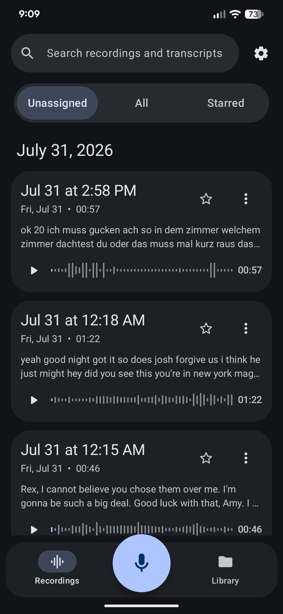

# Voice Memo

Voice Memo is an offline Material 3 Android app for recording, playing,
organizing, and transcribing voice notes. It has no `INTERNET` permission,
cloud account, analytics SDK, or automatic cloud backup.

## Features

- Local recording, playback, organization, and transcript editing
- On-device Whisper and Parakeet transcription
- Local voice activity detection
- User-initiated backup, restore, import, and sharing
- CPU and GPU transcription with automatic CPU fallback

<center></center>

## Build

Voice Memo requires Android Studio's bundled JBR (Java 17 or newer), Android
SDK 36, and an `arm64-v8a` target.

Fetch the pinned model assets, then build and test:

```sh
scripts/fetch-whisper-assets.sh
scripts/fetch-parakeet-assets.sh
scripts/fetch-silero-vad-assets.sh

export JAVA_HOME="/Applications/Android Studio.app/Contents/jbr/Contents/Home"
export ANDROID_HOME="$HOME/Library/Android/sdk"
./gradlew testDebugUnitTest lintDebug assembleDebug
```

The generated model files are ignored by Git and verified by exact size and
SHA-256 during the build. Both transcription models are bundled, so the
standalone APK is large.

## Documentation

- [Offline models and asset provenance](docs/offline-models.md)
- [Transcription benchmarks](docs/transcription-benchmarks.md)
- [Whisper GPU implementation and diagnostics](docs/whisper-gpu-diagnostics.md)

Additional model publication and experiment-specific notes live beside their
artifacts under `model-assets/`, `repro/`, and `blog/`.

## Privacy and storage

Audio, waveform data, transcripts, and resumable transcription state stay in
app-private storage. Android's sharesheet receives only explicit, temporary
`FileProvider` grants. App backup is disabled, and the manifest deliberately
omits `android.permission.INTERNET`.

OpenAI Whisper's MIT notice and LiteRT's Apache-2.0 notice are available in the
in-app Licenses screen.
